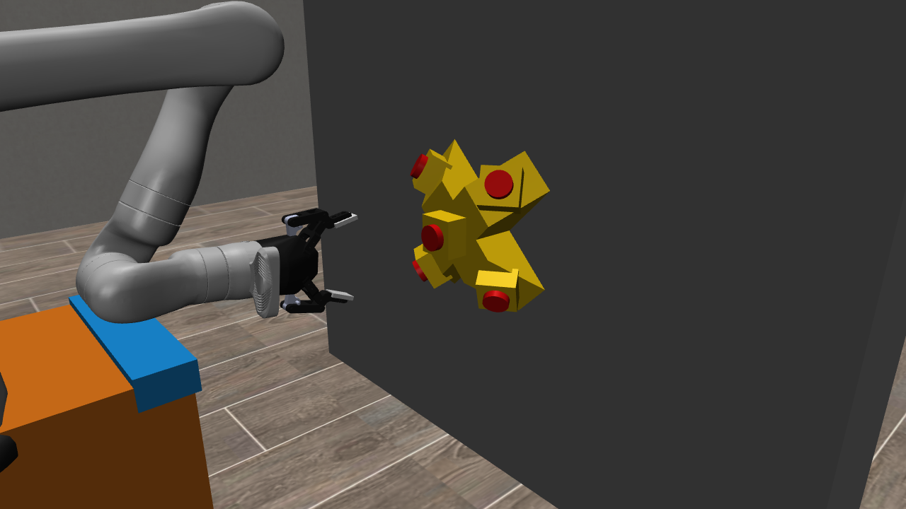
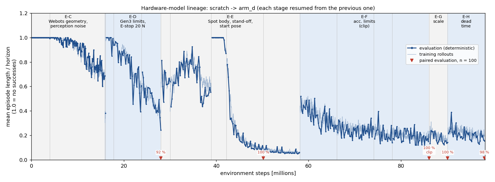

# sim2real-kinova-ppo-rl-in_robosuite

PPO policy for a **Kinova Gen3 6DOF** (Robotiq 2F-85) mounted on a Boston Dynamics
**Spot**, trained in robosuite/MuJoCo to press the five emergency-stop buttons of a
RoboCup Rescue **omniboard**, and a ROS 2 bridge that runs the same policy on the real arm
through `ros2_kortex`. Engineering thesis project.

<p align="center">
  
</p>

**Status (2026-10-19):** the hardware model is trained and evaluated in simulation; the
bridge is verified offline, in Webots and on a mock of `ros2_kortex`. **No session on the
real robot yet.**

## Task

The omniboard is a cross-shaped block whose arms end in 45-degree bevels, mounted on a wall
rolled by 45 degrees. Five latching E-stops sit on it; each needs a different end-effector
orientation. The operator (supervisor) gives the order; the policy gets the current target
as a one-hot and must press all five.

```
        [1]
    [4] [0] [2]      0 = front face, 1-4 on the 45-degree bevels
        [3]
```

## Results (hardware model `arm_d`)

Evaluated in the full hardware envelope: Spot body and front camera in the scene, Gen3
velocity limits (1.39/1.22 rad/s, proportional scaling, tool caps 0.5 m/s / 0.8727 rad/s),
hard acceleration limits 5.2/10 rad/s^2 in firmware (`scale`) semantics, latching E-stop
20 N / 6 mm, horizon 2000 steps (100 s), n = 100 paired episodes:

| loop dead time | success | collision steps/ep (median) |
|---|---|---|
| 0 | 98/100 | 3.46 (0) |
| 1 step = 50 ms | 99/100 | 4.90 (3) |
| 2 steps = 100 ms | 98/100 | 18.74 (11) |

<p align="center">
  
</p>

Learning curve of the whole lineage, from scratch to `arm_d`; every stage resumes from the
previous one, and the shaded bands are environment versions (each new constraint first
breaks the policy, then training recovers it). The metric is mean episode length as a fraction
of the horizon, because an episode ends early only on success; red markers are the paired
n = 100 evaluations. Regenerate with `python training/plots/plot_lineage.py` after
`bash cloud/tb_pull.sh` (cloud runs).

Fallback model `arm_sb`: 100/100 at d = 0 but 93/100 at d = 2. Scene contract per
checkpoint and the exact evaluation command: [`models/README.md`](models/README.md).
How the project got here, with all negative results: [`docs/thesis_notes_en.md`](docs/thesis_notes_en.md)
(English summary) and [`docs/project_documentation_pl.md`](docs/project_documentation_pl.md)
(full journal, Polish).

## Design in one paragraph

The policy sees only what the robot can reproduce: joint states, kinematics, and the target
pose **as perception estimates it** (per-episode bias + per-step noise); button states are not
observed. Action = 6-D OSC_POSE delta at 20 Hz. Training adds the real robot's constraints as
simulator fidelity (limits, latching button, Spot geometry, randomised loop delay 0-2 steps)
rather than as reward terms. On hardware the bridge rebuilds the exact training observation by
running the joint angles through the training MuJoCo model, converts actions to a TOOL-frame
twist for `twist_controller`, and leaves task logic and safety outside the policy.

## Repository layout

```
envs/                    ButtonBoardEnv (the task), Gen3 6DOF registration, OSC scale helpers
objects/, my_assets/     button and omniboard MJCF objects, meshes, 6DOF robot model
training/
  train_board.py         PPO training (YAML config, SubprocVecEnv, curricula, LogStdClamp)
  compare_models.py      paired evaluation (identical episodes per model, CSV, tests)
  watch_board.py         viewer / offscreen recorder (same envelope flags as the evaluation)
  configs/               one YAML per run; header = start, change, criterion, result
  verify_obs_core.py     offline check of the bridge core against the env
  check_wall_robosuite.py, eval_press_detector.py, diag_*.py   diagnostics
  plots/plot_lineage.py  learning curve of the hardware-model lineage (README figure)
ros2_bridge/
  bridge_node.py         the bridge (backends: dry, servo/ik = Webots, kortex = robot)
  obs_core.py            observation core (training MuJoCo model, angle unwrapping)
  twist_out.py           action -> twist filter, caps, frame transforms
  step_test.py           step-response identification and filter retuning
  safety.py              virtual wall for the in-air test
  deadman.py             independent heartbeat watchdog (zero twist + JTC on silence)
  operator_input.py      operator as press detector (Enter / n / q)
  aruco_board.py, aruco_probe.py   board pose from an ArUco marker
  mock_kortex.py         mock of ros2_kortex for rehearsing sessions without the robot
  webots_truth.py, record_demo.py, diag_latency.py   Webots tools
cloud/                   preemption-tolerant GCP training (spot VMs)
models/README.md         model manifest: scene contract and evaluation command per checkpoint
docs/                    documentation, figures, recording scripts (docs/video/*.sh)
```

Trained checkpoints and logs live in `logs/` (git-ignored; backup in GCS).

## Setup

Simulation and training (conda):

```bash
conda create -n robosuite python=3.10 && conda activate robosuite
pip install robosuite==1.5.1 mujoco==3.3.7 numpy==1.26.4 \
            "stable-baselines3[extra]==2.3.2" gymnasium==0.29.1 torch pyyaml opencv-python   # >= 4.7 includes cv2.aruco
```

ROS 2 side: Ubuntu 22.04, ROS 2 Humble, `ros2_kortex` (Kinova upstream) for the robot,
MASKOR `webots_ros2_spot` (branch `kinova_gen3`) for Webots. The bridge runs with the conda
interpreter, which works with ROS because both are Python 3.10:

```bash
source /opt/ros/humble/setup.bash
~/miniconda3/envs/robosuite/bin/python ros2_bridge/bridge_node.py ...
```

Two pitfalls: conda's `base` env must not be active in ROS terminals (`conda config --set
auto_activate_base false`), and every script that loads a PPO model blocks TensorFlow
(`sys.modules["tensorflow"] = None`) before importing SB3, otherwise `PPO.load` segfaults.

## Simulation

```bash
# evaluate the hardware model in its scene (command and flags: models/README.md)
python training/compare_models.py "arm_d=logs/board_6dof/arm_d/checkpoints/ppo_board_98123552_steps.zip" \
  --robot Kinova3_6DOF --episodes 100 --seed 1234 --horizon 2000 \
  --kinova-limits --acc-limits --acc-mode scale --action-delay 0 \
  --estop-config training/configs/ppo_board_6dof_estop_hw.yaml \
  --spot-body --spot-front-cam --base-x-offset=-0.34 \
  --init-qpos="0.0,1.4692,-2.2410,3.1403,-2.0200,3.1416"

# record the same episodes (seed = 1234 + episode index from the CSV)
bash docs/video/record_arm_d.sh

# train / resume (every config header has its launch command)
python training/train_board.py --config training/configs/arm_d.yaml \
  --resume logs/board_6dof/arm_sb/checkpoints/ppo_board_90123552_steps.zip --timesteps 8000000

# offline check of the bridge core (observation bit-exact, closed loop through the core)
python training/verify_obs_core.py --episodes 3
```

`--timesteps` on resume means additional steps. Any evaluation must use the same scene flags
as training; a model loads without error in a different scene and only scores low.

## Running on the robot

Three terminals with `source /opt/ros/humble/setup.bash`. Commands below use
`PY=~/miniconda3/envs/robosuite/bin/python`; outputs go to `logs/hw/` (`mkdir -p logs/hw` first).

**1. Driver.** Start `ros2_kortex` for the 6DOF arm, then make sure both controllers are
loaded: the joint trajectory controller active and `twist_controller` loaded (the bridge
switches between them itself).

```bash
ros2 launch kortex_bringup gen3.launch.py robot_ip:=<ROBOT_IP> dof:=6 gripper:=robotiq_2f_85
ros2 control list_controllers        # joint_trajectory_controller active, twist_controller present
ros2 run controller_manager spawner twist_controller --inactive   # only if it is missing
```

**2. Deadman** (before the bridge, for the whole session). `twist_controller` keeps executing
its last command; if the bridge dies, the deadman sends zeros and switches back to the JTC.

```bash
$PY ros2_bridge/deadman.py
```

**3. Bridge.** At start it homes along a collision-checked path, compares its FK with the
robot's TF (refuses to run above 5 mm / 2 deg), switches to `twist_controller`, and on exit
always sends zeros and switches back to the JTC. `--speed-scale` < 1 reduces the caps for
first runs (this changes the dynamics, so judge directions only).

```bash
# a) step test: twist pulses per axis, no policy; writes step_test_raw.csv and step_test_filter.json
$PY ros2_bridge/bridge_node.py --backend kortex --home-safe --step-test --step-out logs/hw/step_test

# b) in-air test without the board: the board is virtual (nominal pose relative to the base),
#    the virtual wall stops the arm where the real board would be
$PY ros2_bridge/bridge_node.py --backend kortex --home-safe --board nominal \
    --filter-json logs/hw/step_test_filter.json --speed-scale 0.3 \
    --sequence 2,1,4,0,3 --steps 2000 --log-csv logs/hw/air.csv

# c) with the real board: no virtual wall (it failed with a real board), operator detects presses
$PY ros2_bridge/bridge_node.py --backend kortex --home-safe --board <x,y,z[,rx,ry,rz]> --no-wall \
    --filter-json logs/hw/step_test_filter.json --sequence 2,1,4,0,3 --operator \
    --steps 6000 --log-csv logs/hw/board.csv
```

Operator keys (each followed by Enter): **Enter** = button latched (next target), **n** =
skip, **q** = stop. Ctrl+C also stops safely.

**Before the first session, still to do on the robot:**
- read the tool TCP from the Kinova Web App and pass it as `--tool-tcp-z` (default 0.1448 m
  assumes the TCP is set at the grip point);
- `--board aruco` on the robot needs the wrist-camera extrinsic from the Kinova Vision
  calibration added to `aruco_board.py` / `--cam-extrinsic` (today only the Webots value
  exists), the real camera topics checked against the `kortex` profile in `bridge_node.py`,
  and the marker placement on the board measured (`P_BOARD_MARKER`). Until then pass the
  board pose by hand (`--board x,y,z`, base frame, metres) or use `nominal`;
- park Spot so the board sits within the measured tolerance: from 2 cm farther to 4 cm closer
  than in training (board centre at about x = 0.84 m in the arm base frame).

**Rehearsal without the robot.** `mock_kortex.py` imitates the driver (wrapped joint angles,
TF, TOOL-frame twist that holds its last command, JTC, controller manager). Run it instead of
step 1 and use the same commands. It checks the bridge logic, not the policy's success.

```bash
$PY ros2_bridge/mock_kortex.py --dead 0.04 --tau 0.06 --gain 0.95
```

## Webots (sim2sim)

`--backend ik` (Jacobian steps streamed to the JTC) or `--backend servo` (MoveIt Servo), with
`--board webots` (ground truth from the world file) or `--board aruco` (wrist camera). Webots
verifies kinematics, the observation, ArUco and the stand-off; it cannot measure task success
(its buttons have no physics and the model has a 2F-140 gripper). Details: docs 6.58-6.60.

## Training in the cloud

`cloud/` contains the scripts used for the four-arm control campaign: `bundle.sh` packs the
repo and start checkpoint to GCS, `startup.sh` provisions a spot VM idempotently, `run_arm.sh`
resumes from the highest checkpoint after preemption and shuts the VM down when done. See
`cloud/README.md`.

## Acknowledgements

The simulation is built on robosuite:

```bibtex
@inproceedings{robosuite2020,
  title={robosuite: A Modular Simulation Framework and Benchmark for Robot Learning},
  author={Yuke Zhu and Josiah Wong and Ajay Mandlekar and Roberto Mart\'{i}n-Mart\'{i}n and Abhishek Joshi and Soroush Nasiriany and Yifeng Zhu and Kevin Lin},
  booktitle={arXiv preprint arXiv:2009.12293},
  year={2020}
}
```

Other software and work used in this project:

- **MuJoCo**: E. Todorov, T. Erez, Y. Tassa, *MuJoCo: A physics engine for model-based
  control*, IROS 2012.
- **Stable-Baselines3**: A. Raffin et al., *Stable-Baselines3: Reliable Reinforcement Learning
  Implementations*, JMLR 22(268), 2021.
- **PPO**: J. Schulman et al., *Proximal Policy Optimization Algorithms*, arXiv:1707.06347, 2017.
- **ros2_kortex** (Kinova ROS 2 driver): https://github.com/Kinovarobotics/ros2_kortex
- **Gen3 6DOF MJCF model** adapted from https://github.com/goldengeko/robosuite_training_examples
- **Webots Spot + Gen3 world** (MASKOR, FH Aachen): https://github.com/MASKOR/webots_ros2_spot
