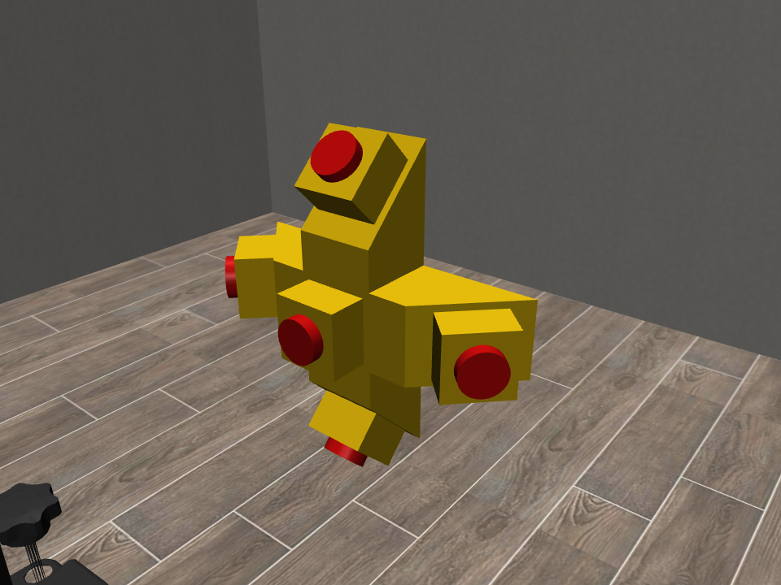
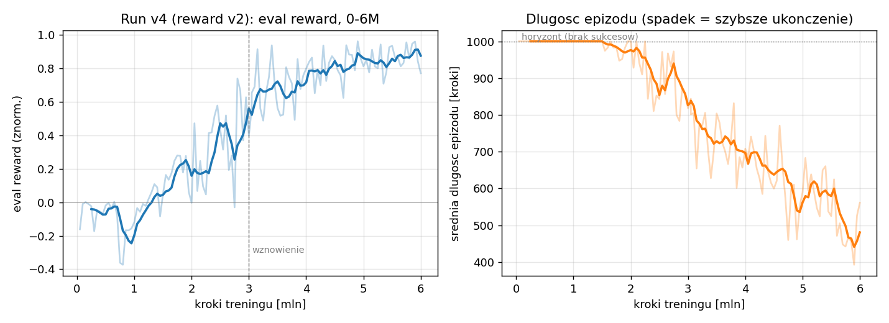

# sim2real-kinova-ppo-rl-in_robosuite

Reinforcement learning (PPO) for a **Kinova Gen3** arm mounted on a Boston Dynamics
**Spot**, trained in simulation (robosuite / MuJoCo) to press the five Emergency-Stop
buttons of a RoboCup Rescue **omniboard** — with the whole setup designed around a
**sim-to-real pipeline**: the policy only observes quantities that are reproducible
on the physical robot.

<p align="center">
  
</p>

## The task

The omniboard is a cross-shaped block (320 × 320 × 80 mm) whose arms end in
**45° bevelled faces**. Five E-Stop buttons are mounted on it:

```
        [1]
    [4] [0] [2]      0 = front face (facing the robot),
        [3]          1–4 = top / right / bottom / left, each on a 45° bevel
```

Each button points in a different direction, so the arm must re-orient its
end-effector for every press. An episode requires pressing all five buttons
(≥ 12 mm spring travel each) in a per-episode randomized order; the current
target is commanded via a one-hot observation (goal-conditioned policy).

## Results

| Metric (best model, 6M training steps) | Value |
|---|---|
| Success rate (100-episode evaluation) | **89 %** |
| Mean time of a successful episode | 528 steps ≈ 26 s |
| Failure modes | mostly benign timeouts (partial progress) |

<p align="center">
  
</p>

A fine-tuning stage (reward v2.1: 10× collision cost, action-rate penalty) further
targets board-contact avoidance and trajectory smoothness for hardware deployment.

## Sim2real design

- **Observations** contain only what the real robot can measure: proprioception
  (joint states, EEF pose from kinematics) plus the target's relative position and
  press axis **as a perception module would estimate them** — corrupted with a
  per-episode bias (board-pose estimation error, e.g. AprilTag) and per-step noise.
- **Button states are not observed** — the physical board is not wired. Press
  detection on hardware uses the arm itself: estimated EEF force (joint torques)
  + push depth from kinematics (≥ 12 mm along the press axis). The task state
  machine (which button is next) lives in a supervisor node, mirrored in the env.
- **Domain randomization**: board position (± 5 cm), press order, perception
  bias/noise on target position and axis.
- **Reward** (v2.1, sim-only, computed from privileged true state):
  potential-based approach shaping `10·(d_prev − d_curr)`, press bonus +25,
  completion bonus +100 (terminal — episode ends on success), collision cost −5,
  action cost −0.01·‖a‖², action-rate cost −0.02·‖aₜ−aₜ₋₁‖².

Full documentation (in Polish, written for the accompanying engineering thesis),
including the failed reward-v1 analysis and eight documented technical pitfalls:
[`docs/dokumentacja_projektu.md`](docs/dokumentacja_projektu.md).

## Repository layout

```
envs/
  button_board.py        ButtonBoardEnv — the omniboard task (main environment)
  button_press.py        single table-mounted button (intermediate task)
  cylinder_inspection.py auxiliary inspection task
objects/                 MujocoXMLObject wrappers (buttons, boards)
my_assets/               meshes (STL) and MJCF object definitions
training/
  train_board.py         PPO training (YAML config, SubprocVecEnv, checkpoints, eval)
  watch_board.py         policy viewer: live window or offscreen --record video
  configs/ppo_board.yaml hyperparameters and env/DR settings
docs/                    project documentation + figures
```

## Setup

```bash
conda create -n robosuite python=3.10
conda activate robosuite
pip install robosuite==1.5.1 mujoco==3.3.7 numpy==1.26.4 \
            "stable-baselines3[extra]==2.3.2" gymnasium==0.29.1 torch pyyaml
```

Tested with: robosuite 1.5.1, MuJoCo 3.3.7, SB3 2.3.2, gymnasium 0.29.1,
torch 2.12 (CUDA), Python 3.10, Ubuntu 22.04.

> **Note:** every script that calls `PPO.load` must block the TensorFlow import
> (`sys.modules["tensorflow"] = None`) *before* importing stable-baselines3 —
> TF (pulled in via tensorboard) breaks the lazy `torch._dynamo` import and
> segfaults. See docs §7.6.

## Usage

```bash
# train from scratch (config: training/configs/ppo_board.yaml)
python training/train_board.py

# resume from a checkpoint for N additional steps
python training/train_board.py --resume logs/board/checkpoints/ppo_board_XXXXXXX_steps.zip --timesteps 2000000

# watch the current best policy in a live MuJoCo window
python training/watch_board.py

# record a video instead (headless-friendly: EGL + ffmpeg)
python training/watch_board.py --record rollout.mp4 --episodes 5

# learning curves
tensorboard --logdir logs/tensorboard
```

Training artifacts (checkpoints every 100k steps, best model by evaluation,
TensorBoard events) are written to `logs/` (git-ignored).

## Hardware pipeline (next stage)

```
camera ─► board 6D pose (AprilTag; YOLO+depth as extension)
       ─► 5 button positions + press axes from CAD geometry
       ─► PPO policy (same observation vector as in sim)
       ─► OSC deltas ─► Kinova Gen3
press detection: EEF force (joint torques) + push depth (kinematics)
       ─► supervisor state machine advances the target one-hot
```
